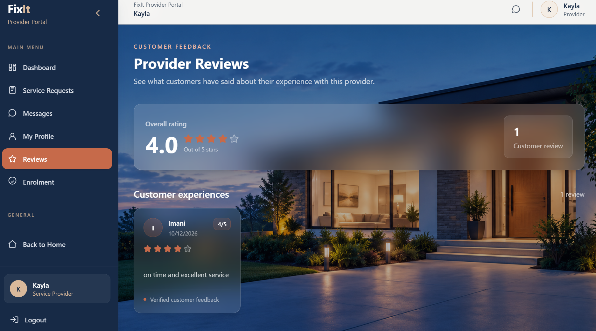
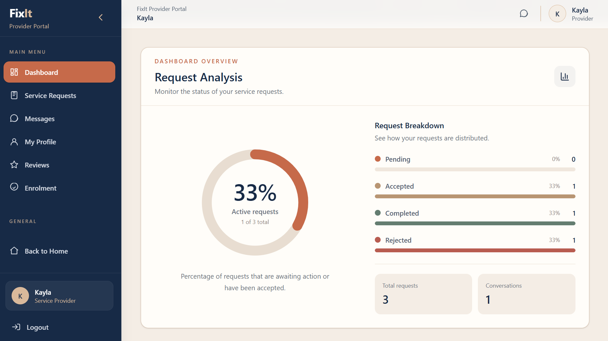
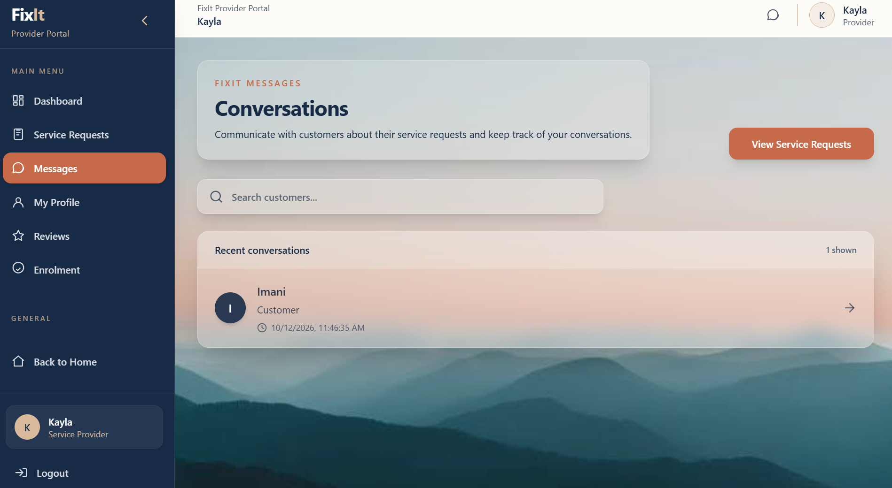

# FixIt

## Connecting Customers with Trusted Service Providers

FixIt is a web-based local services marketplace that connects customers with service providers such as plumbers, electricians, carpenters, painters, appliance repair technicians, and other professionals.

The platform makes it easier for customers to discover service providers, review their profiles, submit service requests, communicate with providers, and share feedback. Service providers can establish an online presence, showcase their expertise, manage customer requests, and participate in the platform's subscription and enrolment process.

FixIt aims to make finding a trusted professional as convenient as ordering a service online.

## Table of Contents

- [About the Project](#about-the-project)
- [Problem Statement](#problem-statement)
- [Proposed Solution](#proposed-solution)
- [Features](#features)
- [User Roles](#user-roles)
- [Example Service Categories](#example-service-categories)
- [Technology Stack](#technology-stack)
- [System Architecture](#system-architecture)
- [Project Structure](#project-structure)
- [Prerequisites](#prerequisites)
- [Installation and Setup](#installation-and-setup)
- [Environment Configuration](#environment-configuration)
- [Running the Application](#running-the-application)
- [API Documentation](#api-documentation)
- [Authentication and Security](#authentication-and-security)
- [Deployment](#deployment)
- [Testing](#testing)
- [Contributing](#contributing)
- [Future Improvements](#future-improvements)
- [License](#license)
- [Author](#author)

## About the Project

Finding reliable service providers can be challenging, particularly when customers have limited access to trustworthy information about available professionals. Service providers may also struggle to reach new customers and establish a professional online presence.

FixIt addresses these challenges by bringing customers and service providers together through a centralized digital marketplace.

The application has a React frontend and a Django REST Framework backend. The frontend communicates with the backend through REST API endpoints, keeping the presentation layer separate from application logic and data management.

The platform includes customer accounts, service provider profiles, service requests, messaging, reviews, provider enrolment, payment management, and administrative functionality.

## Problem Statement

Customers often rely on personal recommendations, informal contacts, or multiple online platforms to find service providers. This process can be time-consuming and may not provide enough information to make informed decisions.

Service providers, particularly independent professionals and small businesses, may lack an accessible platform through which to advertise their services, connect with customers, and build credibility.

## Proposed Solution

FixIt aims to address these challenges by providing a centralized marketplace where customers can discover professionals and service providers can reach potential customers.

## Features

### Customer Features

- Customer registration and login.
- JWT-based authentication.
- Secure logout.
- Customer dashboard.
- Search and filter service providers.
- Browse providers by service category and location.
- View service provider profiles and professional information.
- Submit service requests to selected providers.
- View and manage service requests.
- Communicate with service providers through messaging.
- View and submit reviews and ratings through the reviews functionality.




### Service Provider Features

- Service provider registration and login.
- Provider dashboard.
- Create and update a professional service provider profile.
- Specify service categories, location, experience, and contact information.
- Browse and manage provider profile information.
- Receive and manage customer service requests.
- Communicate with customers.
- Receive customer reviews and ratings.
- Submit provider enrolment information.
- Upload supporting professional qualification documents where required.
- Participate in the provider subscription and payment workflow.
- Track enrolment and payment status.




### Administrator Features

- Administrative dashboard.
- View and manage user accounts.
- Review provider enrolment applications.
- View submitted provider information and supporting documents.
- Approve or reject provider enrolments.
- View and manage payment records.
- Approve or reject payment submissions where applicable.
- View and manage service requests.
- Monitor reviews and ratings through the relevant management functionality.
- Access platform reports and administrative summaries.

Feature availability depends on the relevant account permissions and the implemented workflow.

## User Roles

FixIt has three primary user roles.

### Customer

Customers use FixIt to discover service providers, submit service requests, communicate with professionals, manage their requests, and provide feedback.

### Service Provider

Service providers use FixIt to advertise their services, maintain professional profiles, receive customer requests, communicate with customers, and participate in the enrolment and subscription process.

### Administrator

Administrators oversee platform operations, manage user accounts, review provider enrolments, process payment approvals, and monitor service requests and reports.

## Service Categories

FixIt is designed to support a variety of local services, including:

- Plumbing
- Electrical services
- Carpentry
- Painting
- Appliance repair
- Cleaning
- Pest control
- Packers and movers
- Water tank refill services
- General maintenance and other local professional services

### A key functionality of the application is messaging, through which customers and providers communicate



## Technology Stack

### Frontend

- React
- JavaScript
- HTML5
- CSS
- Tailwind CSS
- React Router
- Vite
- Recharts
- Lucide React

### Backend

- Python
- Django
- Django REST Framework
- Django REST Framework Simple JWT

### Database

- SQLite for local development.
- PostgreSQL for the production deployment configuration.

### Authentication and Authorization

- JSON Web Tokens (JWT).
- Access and refresh tokens.
- Role-based access for customers, service providers, and administrators.
- Django and Django REST Framework permissions.

### Communication

- REST APIs for frontend-backend communication.
- Application-level messaging between customers and service providers.

### Payments

- Provider subscription and payment management.
- Payment reference and transaction information.
- Administrative payment review and approval.

### Development and Deployment Tools

- Git and GitHub
- Visual Studio Code
- Postman
- Node.js and npm
- Python virtual environments
- Vercel for frontend deployment
- Render for backend deployment

## System Architecture

FixIt uses a client-server architecture in which the React frontend communicates with the Django REST API.

```text
                       FIXIT
                         |
                  React Frontend
                    (Vite)
                         |
                     REST API
                         |
              Django REST Framework
                         |
             +-----------+-----------+
             |           |           |
          Accounts    Providers   Service Requests
             |           |           |
             +-----------+-----------+
                         |
              +----------+----------+
              |          |          |
          Messaging    Reviews    Payments
              |          |          |
              +----------+----------+
                         |
                 Database Layer
                         |
               +---------+---------+
               |                   |
             SQLite            PostgreSQL
          Development          Production
                         |
                 Administration
```

The frontend is responsible for the user interface and user interactions. The Django backend handles authentication, validation, business logic, permissions, and database operations.

The database stores application data, including accounts, provider profiles, service requests, reviews, and payment-related records.

## Project Structure

The repository contains the Django backend at the root level and the React frontend in the `frontend/` directory.

```text
FixIt/
├── accounts/
├── administration/
├── messaging/
├── payments/
├── provider_qualifications/
├── providers/
├── reviews/
├── service_requests/
├── fixit_project/
├── frontend/
│   ├── public/
│   ├── src/
│   │   ├── components/
│   │   ├── pages/
│   │   ├── services/
│   │   └── ...
│   ├── package.json
│   └── ...
├── manage.py
├── requirements.txt
├── package.json
├── db.sqlite3
├── build.sh
└── README.md
```

## Backend Applications

| Application | Responsibility |
|---|---|
| `accounts` | User accounts, registration, authentication, and account management |
| `providers` | Provider profiles, service categories, and enrolment |
| `provider_qualifications` | Professional qualification information and supporting documents |
| `service_requests` | Customer service request management |
| `messaging` | Customer-provider conversations and messages |
| `reviews` | Customer feedback and ratings |
| `payments` | Provider subscription and payment management |
| `administration` | Administrative operations, approvals, and reports |
| `fixit_project` | Django project configuration and root URL routing |

The frontend `components/` directory contains reusable interface components, `pages/` contains application pages, and `services/` contains modules that communicate with the backend API.

Generated files, local databases, environment files, and other machine-specific files should be excluded from version control where appropriate.

## Prerequisites

Before installing FixIt locally, ensure that you have the following:

- Git
- Python and pip
- Node.js and npm
- Visual Studio Code or another code editor
- A terminal such as PowerShell, Command Prompt, or Git Bash

Check your installed versions:

```bash
git --version
python --version
pip --version
node --version
npm --version
```

Use Python and Node.js versions compatible with the project's dependencies.

## Installation and Setup

### 1. Clone the Repository

```bash
git clone https://github.com/imaninaitore/FixIt.git
cd FixIt
```

### 2. Set Up the Django Backend

Create a Python virtual environment from the project root:

```bash
python -m venv my_env
```

Activate the environment on Windows PowerShell:

```powershell
.\my_env\Scripts\Activate.ps1
```

For Windows Command Prompt:

```bat
my_env\Scripts\activate.bat
```

Install the Python dependencies:

```bash
pip install -r requirements.txt
```

Apply database migrations:

```bash
python manage.py migrate
```

Create an administrator account if required:

```bash
python manage.py createsuperuser
```

Start the Django development server:

```bash
python manage.py runserver
```

The backend will normally run at:

`http://127.0.0.1:8000/`

The API base URL for local development is:

`http://127.0.0.1:8000/api/`

### 3. Set Up the React Frontend

Open a second terminal and navigate to the frontend directory:

```bash
cd frontend
```

Install the JavaScript dependencies:

```bash
npm install
```

Start the Vite development server:

```bash
npm run dev
```

Open the local URL displayed in the terminal.

Keep both development servers running while using the application locally.

## Environment Configuration

FixIt requires the frontend and backend to communicate using the correct API base URL.

### Local Development

The frontend API base URL is:

```text
http://127.0.0.1:8000/api
```

The API URL is configured in the frontend service layer.

### Production Configuration

The deployed backend API is:

```text
https://fixit-api-9pjj.onrender.com/api
```

The deployed frontend is:

```text
https://fix-it-cyan.vercel.app
```

These URLs are provided for the current deployment configuration and may change if the services are renamed or redeployed under different domains.

### Sensitive Configuration

Configure Django settings and environment variables according to the deployment environment.

Sensitive values, including Django secret keys, database credentials, and other private configuration, must not be committed to GitHub.

Production configuration should use appropriate security settings, restricted allowed hosts, HTTPS, and explicitly configured trusted frontend origins.

## Running the Application

Once both servers are running:

1. Open the FixIt frontend in your browser.
2. Register as a customer or service provider.
3. Log in using your account credentials.
4. Access the dashboard associated with your account type.
5. Search for service providers and explore their profiles.
6. Submit a service request to a selected provider.
7. Use the messaging functionality to communicate with service providers.
8. Manage service requests and access available review functionality.
9. Service providers can maintain their profiles and submit enrolment information.
10. Administrators can access the administrative dashboard to manage platform operations.

Some actions depend on account permissions, enrolment status, and the completion of the corresponding workflow.

## API Documentation

FixIt provides a REST API for account management, provider discovery, service requests, reviews, payments, messaging, and administration.

### Base URLs

| Environment | Base URL |
|---|---|
| Local development | `http://127.0.0.1:8000/api/` |
| Production | `https://fixit-api-9pjj.onrender.com/api/` |

All endpoint paths below are relative to the applicable base URL.

### 1. Authentication and Accounts

Base path: `/auth/`

| Endpoint | Method | Purpose |
|---|---|---|
| `/auth/register/` | POST | Register a new account. |
| `/auth/login/` | POST | Authenticate a user and obtain authentication tokens. |
| `/auth/logout/` | POST | Log out a user. |
| `/auth/refresh/` | POST | Obtain a refreshed access token using a refresh token. |
| `/auth/me/` | GET | Retrieve the authenticated user's profile. |

### 2. Providers

Base path: `/providers/`

| Endpoint | Purpose |
|---|---|
| `/providers/` | Retrieve the public provider directory. |
| `/providers/categories/` | Retrieve available provider service categories. |
| `/providers/find/` | Access the provider-finding view. |
| `/providers/me/` | Access the current provider's profile. |
| `/providers/<provider_id>/` | Retrieve a specific provider's public profile. |
| `/providers/enrolment/submit/` | Submit a provider enrolment. |
| `/providers/enrolment/me/` | Retrieve the current provider's enrolment. |
| `/providers/enrolment/me/update/` | Update the current provider's enrolment. |
| `/providers/enrolment/me/withdraw/` | Withdraw the current provider's enrolment. |
| `/providers/enrolment/<enrolment_id>/approve/` | Approve a provider enrolment. |
| `/providers/enrolment/<enrolment_id>/qualification-document/` | Download a provider's qualification document. |

The qualification-document download endpoint is intended for staff according to the URL configuration comments.

### 3. Service Requests

Base path: `/requests/`

| Endpoint | Method | Purpose |
|---|---|---|
| `/requests/` | GET, POST | Retrieve the logged-in customer's service requests or create a new request. |
| `/requests/provider/` | To verify | Retrieve service requests associated with a provider. |
| `/requests/<request_id>/` | To verify | Access an individual service request. |
| `/requests/<request_id>/accept/` | To verify | Accept a service request. |
| `/requests/<request_id>/reject/` | To verify | Reject a service request. |
| `/requests/<request_id>/status/` | To verify | Update a service request's status. |
| `/requests/<request_id>/complete/` | To verify | Mark a service request as completed. |

The list endpoint explicitly supports GET and POST in the URL configuration comments. The methods and permissions for the other endpoints should be confirmed from their view functions.

### 4. Reviews and Ratings

Base path: `/reviews/`

| Endpoint | Purpose |
|---|---|
| `/reviews/providers/<provider_id>/reviews/` | Retrieve or manage reviews for a specific provider. |
| `/reviews/reviews/<review_id>/` | Access an individual review. |
| `/reviews/providers/<provider_id>/rating/` | Retrieve a provider's rating summary. |
| `/reviews/my-reviews/` | Access reviews associated with the authenticated user. |
| `/reviews/pending/` | Retrieve reviews that are pending. |

The exact supported methods and access permissions for each review endpoint should be verified from the corresponding views.

### 5. Payments

Base path: `/payments/`

| Endpoint | Purpose |
|---|---|
| `/payments/information/` | Retrieve payment information. |

This is the only payment endpoint registered in `payments/urls.py`. Provider enrolment payment submission and administrative payment approval are registered under their respective provider and administration URL prefixes.

### 6. Administration

Base path: `/admin/`

These endpoints are registered under `/api/admin/` and are intended for administrative operations. Confirm the permissions in the corresponding view functions.

#### User management

| Endpoint | Purpose |
|---|---|
| `/admin/users/` | Manage or retrieve users. |
| `/admin/users/<user_id>/` | Access an individual user's administrative details. |
| `/admin/users/<user_id>/status/` | Manage a user's status. |

#### Provider enrolments

| Endpoint | Purpose |
|---|---|
| `/admin/enrolments/` | Retrieve and manage provider enrolments. |
| `/admin/enrolments/<enrolment_id>/` | Access an individual enrolment. |
| `/admin/enrolments/<enrolment_id>/approve/` | Approve an enrolment. |
| `/admin/enrolments/<enrolment_id>/reject/` | Reject an enrolment. |

#### Service requests

| Endpoint | Purpose |
|---|---|
| `/admin/requests/` | Retrieve and manage service requests through the administration interface. |

#### Payment management

| Endpoint | Purpose |
|---|---|
| `/admin/payments/` | Retrieve and manage payments. |
| `/admin/payments/<payment_id>/approve/` | Approve a payment. |
| `/admin/payments/<payment_id>/reject/` | Reject a payment. |

#### Reports and dashboard

| Endpoint | Purpose |
|---|---|
| `/admin/reports/` | Retrieve administrative reports. |
| `/admin/dashboard/` | Retrieve administrative dashboard information. |

### 7. Messaging

Messaging endpoints are not listed in this section yet. Add them after confirming the routes registered in `messaging/urls.py`.

### Notes

- Endpoints requiring authentication should be accessed using the authentication mechanism configured by the backend.
- HTTP methods, request bodies, response formats, and permissions should be documented according to the corresponding view implementations.
- Replace placeholder identifiers such as `<provider_id>`, `<request_id>`, `<review_id>`, `<user_id>`, `<enrolment_id>`, and `<payment_id>` with actual record IDs.
- The Django administration website at `/admin/` is separate from the REST API endpoints under `/api/admin/`.


## Deployment

FixIt uses a separate frontend and backend deployment architecture.

### Frontend

The React application is deployed through Vercel.

Production frontend:

https://fix-it-cyan.vercel.app

### Backend

The Django REST API is deployed through Render.

Production API:

https://fixit-api-9pjj.onrender.com/api/

### Database

SQLite is used for local development. PostgreSQL is intended for the production environment.

The production database must be configured through the deployment environment rather than relying on a local SQLite database file.

### Deployment Considerations

- Configure production environment variables.
- Set the correct frontend API base URL.
- Configure Django allowed hosts and CORS.
- Run database migrations during deployment.
- Keep credentials and secret keys out of source control.
- Ensure uploaded media and supporting documents use suitable persistent storage.
- Verify that API endpoints and authentication work against the deployed backend.


## Contributing

Contributions, bug reports, and suggestions are welcome.

To contribute:

1. Fork the repository.
2. Create a branch for your changes.
3. Implement the feature or fix.
4. Test your changes.
5. Commit your work using descriptive commit messages.
6. Push the branch to your fork.
7. Open a pull request describing your changes.

Please avoid committing credentials, local environment files, database files containing private information, generated build artifacts, or unrelated changes.

## Future Improvements

Potential improvements and extensions include:

- Completing and refining the service completion and review workflow.
- Provider verification and qualification review.
- Email notifications for important service request updates.
- Push notifications.
- Provider availability and scheduling.
- Enhanced location-based provider discovery.
- Customer favourites and saved providers.
- Advanced provider analytics.
- Dispute management.
- Expanded payment gateway integration.
- Automated testing and continuous integration.
- A dedicated mobile application.
- AI-assisted provider recommendations.

These items represent potential enhancements and should not be interpreted as features already implemented.

## License

This project is licensed under the MIT License.

See the [LICENSE](LICENSE) file for the complete license text.

## Author

**Imani Naitore**